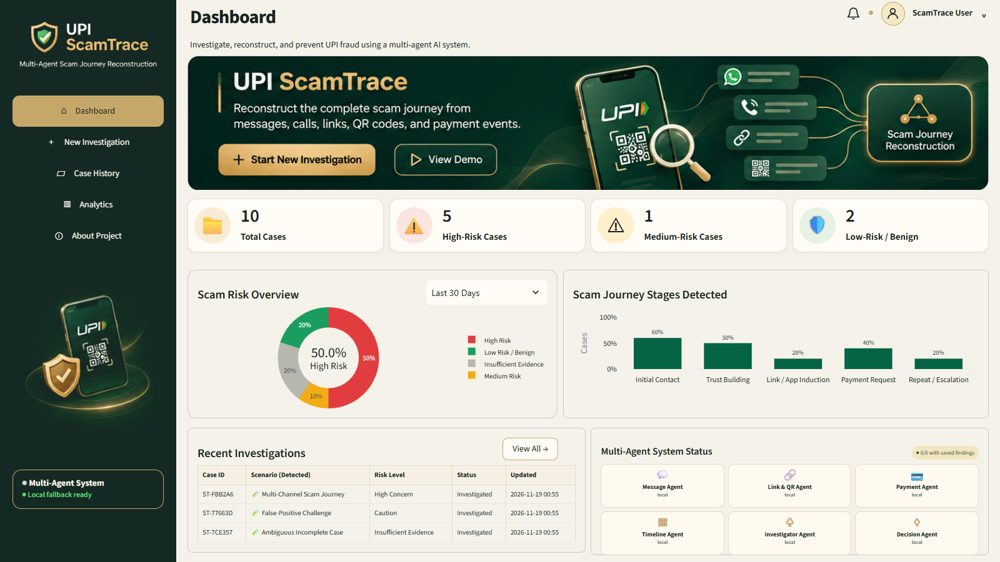
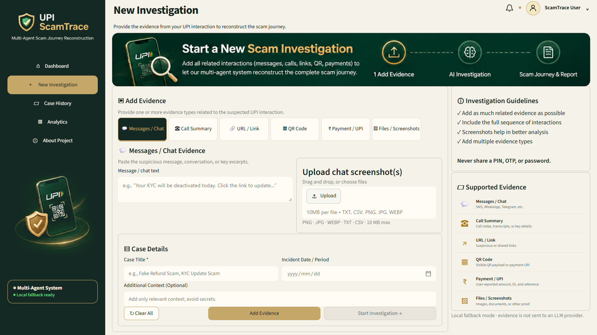
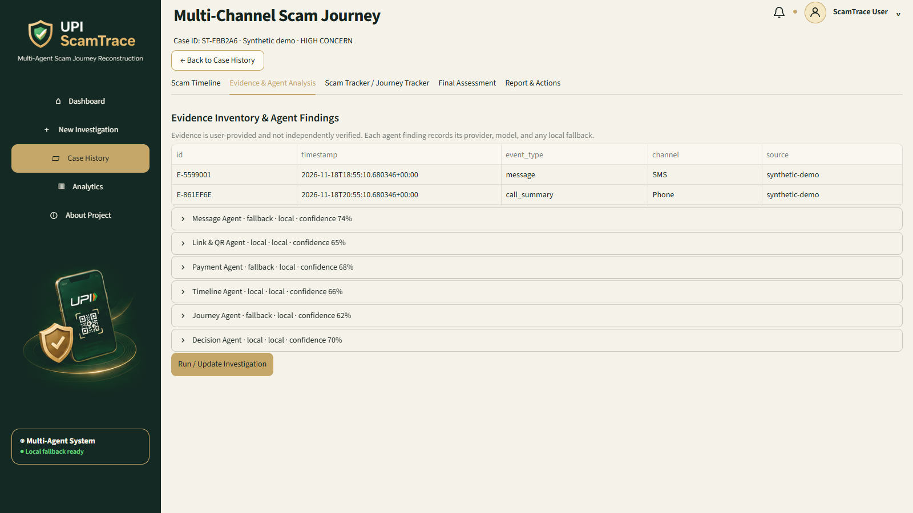
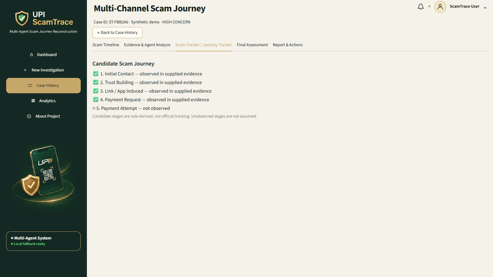
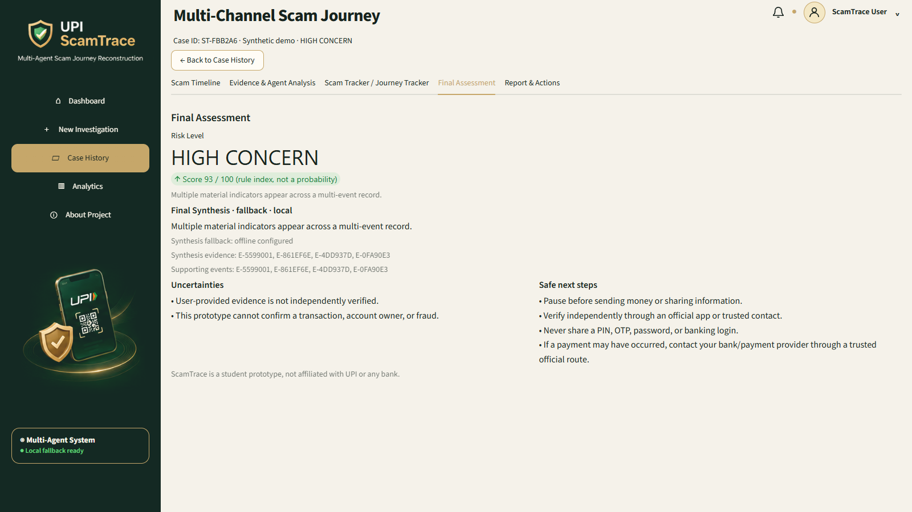
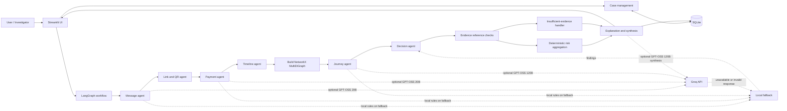
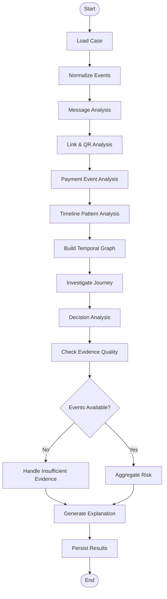
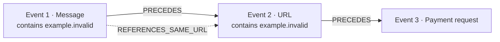
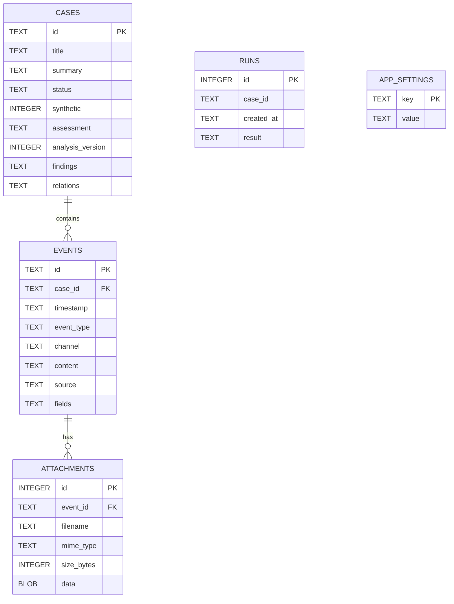

# UPI ScamTrace

### Multi-Agent Scam Journey Reconstruction and Evidence-Based Risk Assessment

<p align="center"><strong>An evidence-oriented investigation prototype that organizes user-submitted UPI scam evidence, reconstructs suspected journeys, and explains potential risk indicators.</strong></p>

<p align="center">
  
  
  
  
  
  
</p>

---

## Overview

UPI ScamTrace is a multi-agent investigation prototype designed to help organize and analyze user-submitted evidence related to suspected UPI scams.

Digital payment scams often involve multiple connected events, such as suspicious messages, impersonation attempts, external links, payment requests, and repeated communication. Looking at these events individually can make it difficult to understand the overall sequence.

UPI ScamTrace addresses this problem by processing supplied evidence through six specialist analysis agents, organizing events chronologically, identifying relationships between evidence items, and generating an explainable, rule-based risk assessment.

Instead of treating every suspicious message as an isolated incident, the system builds an evidence-based view of the reported journey.

**The primary objective is to make the investigation process more structured, traceable, and understandable.**

## Application Preview

The following screenshots were captured from the running Streamlit application using labeled synthetic cases in local fallback mode. They show the current interface and are not mockups.

### Dashboard



*Dashboard metrics and charts populated from ten labeled synthetic demonstration cases.*

### New Investigation



*Evidence intake form for messages, call summaries, URLs, QR payload text, reported payments, and file attachments.*

### Investigation Findings



*Evidence inventory and six specialist findings from a synthetic multi-channel case, processed in local fallback mode.*

### Candidate Scam Journey



*Rule-derived journey stages for a synthetic case. This is the current UI journey view; the NetworkX event graph itself is persisted as relations but is not yet visualized in the interface.*

### Investigation Results



*Rule-based assessment, evidence references, uncertainty statements, and safe next steps. The accompanying Report & Actions tab exports Markdown and JSON.*

---

## Key Features

### 1. Case Management

- Create and manage individual investigation cases.
- Store timestamped evidence events.
- Maintain case history and investigation versions.
- Add new evidence and run an updated investigation.
- Delete cases when they are no longer required.

### 2. Multi-Agent Evidence Analysis

The system uses six specialist agents, coordinated through a LangGraph workflow.

Each agent focuses on a different aspect of the submitted evidence:

- Message analysis
- Link and URL analysis
- Payment-event analysis
- Timeline pattern analysis
- Scam journey investigation
- Decision analysis

### 3. Temporal Evidence Reconstruction

UPI ScamTrace uses NetworkX to construct a directed multi-graph from the supplied events.

The graph currently supports two relationship types:

- `PRECEDES` — represents chronological ordering between consecutive events.
- `REFERENCES_SAME_URL` — connects events containing the same normalized URL string.

Each relationship retains references to the evidence events that support it.

### 4. Explainable Risk Assessment

The final risk assessment is calculated using deterministic rules rather than allowing an LLM to independently decide the risk score.

The system considers:

- Identified risk indicators
- Indicator severity
- Number of supplied events
- Supporting event references
- Missing or uncertain evidence

The assessment produces a risk category, numerical score, explanation, uncertainties, alternative interpretations, and recommended precautions.

### 5. AI-Assisted Analysis with Local Fallback

Groq API integration provides structured model-assisted analysis for selected agents.

When the API is unavailable, credentials are missing, or a response cannot be validated, the system can fall back to local deterministic analysis.

This allows the investigation workflow to remain usable without depending entirely on an external model.

### 6. Evidence Attachments

- Attach supported image files to evidence events.
- Store uploaded attachment data locally in SQLite.
- Retrieve and download attachments through the case interface.

**Note:** Uploaded images are stored as evidence attachments. OCR and QR-code image decoding are not implemented in the current version.

### 7. Investigation Reports

The application supports investigation review and report export in:

- Markdown
- JSON

Reports include structured findings and the generated risk assessment.

### 8. Analytics and Synthetic Scenarios

- Review investigation activity through the analytics interface.
- Load labeled synthetic scenarios.
- Examine scam, benign, ambiguous, and false-positive control cases.
- Run the included deterministic evaluation fixtures in offline mode.

---

## System Architecture

UPI ScamTrace follows a modular architecture in which the Streamlit interface, investigation workflow, specialist agents, evidence graph, database, and optional LLM provider work together.



### Architecture Components

| Component         | Responsibility                                                    |
| ----------------- | ----------------------------------------------------------------- |
| Streamlit UI      | Provides the user-facing investigation interface                  |
| Case Management   | Creates, updates, retrieves, and deletes investigation cases      |
| LangGraph         | Coordinates the sequential investigation workflow                 |
| Specialist Agents | Analyze different categories of submitted evidence                |
| Groq Provider     | Provides optional structured LLM-based analysis                   |
| Local Fallback    | Provides deterministic analysis when model calls are unavailable  |
| NetworkX          | Builds the temporal evidence relationship graph                   |
| Risk Aggregation  | Calculates the final rule-based risk assessment                   |
| SQLite            | Stores cases, events, attachments, runs, and application settings |
| Report Generation | Produces structured Markdown and JSON reports                     |

---

## Multi-Agent Investigation System

The investigation process is divided into six specialist agents.

| Agent | Evidence input | Output and responsibility |
| --- | --- | --- |
| Message Agent | Submitted message and call-summary text | Flags configured social-engineering indicators and cites event IDs. |
| Link & QR Agent | Visible URL patterns in submitted text | Records visible links as indicators; it does not open links or decode QR images. |
| Payment Agent | User-reported payment requests, attempts, or payment-like text | Distinguishes a reported request from a reported attempt and cites related events; it cannot verify settlement. |
| Timeline Agent | Event timestamps and channels | Orders the supplied events and notes channel transitions. |
| Journey Agent | Events and earlier specialist findings | Produces a cautious candidate sequence grounded in event references. |
| Decision Agent | Specialist findings and event references | Summarizes application of deterministic risk rules; does not call the LLM to set the score. |

### Agent Execution

The agents are executed sequentially through the LangGraph workflow. They are not six independently running parallel services.

The workflow maintains a shared investigation state containing the case, events, findings, relationships, assessment, and execution information.

### Model Routing

The current configuration supports two Groq model settings:

| Model Setting | Default Model         | Intended Use                          |
| ------------- | --------------------- | ------------------------------------- |
| Simple model  | `openai/gpt-oss-20b`  | Message and payment classification    |
| Complex model | `openai/gpt-oss-120b` | Journey reasoning and final synthesis |

The simple-model path can also be disabled to use local rules for the corresponding analysis.

**Important:** The model-generated synthesis does not determine or override the deterministic risk score.

---

## Investigation Workflow

The LangGraph workflow coordinates the investigation through the following stages:



### Workflow Stages

1. **Load Case:** Retrieves the selected case and its stored evidence.
2. **Normalize Events:** Ensures that evidence events have usable timestamps.
3. **Message Analysis:** Examines supplied communication for suspicious language.
4. **Link & QR Analysis:** Processes URL-related information available in event content.
5. **Payment Event Analysis:** Reviews user-reported payment-related evidence.
6. **Timeline Pattern Analysis:** Examines chronological patterns.
7. **Build Temporal Graph:** Creates event relationships using NetworkX.
8. **Investigate Journey:** Examines how the available evidence may be connected.
9. **Decision Analysis:** Generates a structured decision-oriented finding.
10. **Check Evidence Quality:** Validates that findings refer to existing evidence events.
11. **Aggregate Risk:** Applies deterministic rules to the identified indicators.
12. **Generate Explanation:** Produces an explanation, uncertainties, alternatives, and recommendations.
13. **Persist Results:** Stores the findings, assessment, relationships, and investigation version.

If no evidence events are available, the workflow follows the insufficient-evidence path instead of treating the case as a confirmed scam.

---

## Temporal Evidence Graph

The temporal evidence graph is a backend data structure built during investigation. The current UI shows timeline and rule-derived candidate journey views, but does not render the NetworkX graph visually.

It represents supplied evidence as event nodes and connects events using relationships supported by their timestamps or URL content.

### Graph Representation

- **Nodes:** Individual evidence events.
- **Directed edges:** Relationships between evidence events.
- **Graph type:** NetworkX `MultiDiGraph`.

### Supported Relationships

| Relationship          | Meaning                                                       | Basis                            |
| --------------------- | ------------------------------------------------------------- | -------------------------------- |
| `PRECEDES`            | One event occurs before the next event in chronological order | Supplied timestamps              |
| `REFERENCES_SAME_URL` | Two events contain the same extracted URL after lowercase and trailing-punctuation normalization | URL text parsing |

These relationships are deliberately limited to what the current implementation can support. The graph does not establish that a payment was completed, that two accounts belong to the same person, or that a URL is malicious.



This is a documentation example of relations supported by the graph builder; its event labels are illustrative, not an additional application screenshot.

---

## Risk Assessment Methodology

The final risk assessment uses a deterministic, rule-based aggregation process. Only medium- and high-severity indicators contribute material indicator codes. The implementation then combines the number of events with those codes using the rules below:

- No events, or one event without a material indicator, produces `INSUFFICIENT_EVIDENCE` with score `0`.
- A multi-event case is `HIGH_CONCERN` when it contains a credential request, repeated payment request, the combination of impersonation and unclear payment direction, or at least three distinct material indicator codes. Its score is `min(95, 65 + 7 × distinct-code-count)`.
- If no high-concern condition applies, two or more material codes produce `CAUTION` with score `min(70, 35 + 9 × distinct-code-count)`; one material code produces `CAUTION` with score `38`.
- Otherwise the case is `LOW_CONCERN` with score `12`.

The score is a rule index for this prototype, not a probability. LLM-generated synthesis cannot change it.

### Assessment Categories

| Category                | Interpretation                                                           |
| ----------------------- | ------------------------------------------------------------------------ |
| `HIGH_CONCERN`          | Multiple material indicators appear across a multi-event record          |
| `CAUTION`               | One or more indicators require careful verification                      |
| `LOW_CONCERN`           | No strong rule-based indicators were identified in the supplied evidence |
| `INSUFFICIENT_EVIDENCE` | The available evidence is not sufficient for a meaningful assessment     |

The numerical score is an internal prototype assessment score. It is **not** a calibrated fraud probability, a bank-issued risk score, or a statistically validated prediction of fraud.

### Assessment Output

The generated assessment can include:

- Risk category
- Numerical assessment score
- Explanation of the assessment
- Identified reason codes
- Supporting evidence event IDs
- Uncertainties
- Alternative interpretations
- Recommended precautions
- Investigation update timestamp

---

## Database Design

UPI ScamTrace uses SQLite for local persistence.

The database is initialized automatically when the application starts.

### Database Tables and Fields

The following names and columns match the SQLite schema initialized by `src/scamtrace/database.py`.

| Table | Fields (type) | Keys and purpose |
| --- | --- | --- |
| `cases` | `id` TEXT, `title` TEXT NOT NULL, `summary` TEXT DEFAULT '', `created_at` TEXT, `updated_at` TEXT, `status` TEXT DEFAULT 'New', `synthetic` INTEGER DEFAULT 0, `assessment` TEXT (JSON), `analysis_version` INTEGER DEFAULT 0, `findings` TEXT (JSON), `relations` TEXT (JSON) | `id` is the primary key. Stores case metadata and the latest saved analysis. |
| `events` | `id` TEXT, `case_id` TEXT NOT NULL, `timestamp` TEXT, `event_type` TEXT, `channel` TEXT, `content` TEXT, `source` TEXT, `fields` TEXT (JSON) | `id` is the primary key. `case_id` references `cases.id` with `ON DELETE CASCADE`. |
| `attachments` | `id` INTEGER, `event_id` TEXT NOT NULL, `filename` TEXT, `mime_type` TEXT, `size_bytes` INTEGER, `data` BLOB NOT NULL | `id` is an auto-increment primary key. `event_id` references `events.id` with `ON DELETE CASCADE`. |
| `runs` | `id` INTEGER, `case_id` TEXT, `created_at` TEXT, `result` TEXT (JSON) | `id` is an auto-increment primary key. `case_id` is stored as a value but is not declared as a foreign key in the current schema. |
| `app_settings` | `key` TEXT, `value` TEXT NOT NULL | `key` is the primary key. Stores application preferences. |



The `runs.case_id` value has no declared foreign-key constraint in the current schema. SQLite foreign-key enforcement is enabled for the `cases → events → attachments` cascade. The default database location is `data/scamtrace.db`; `SCAMTRACE_DB_PATH` changes it.
---

## Technology Stack

| Technology    | Purpose                                                        |
| ------------- | -------------------------------------------------------------- |
| Python        | Core application and investigation logic                       |
| Streamlit     | Interactive web application                                    |
| LangGraph     | Stateful investigation workflow orchestration                  |
| Groq API      | Optional LLM-based structured analysis                         |
| GPT-OSS 20B   | Configurable model for selected simpler analysis tasks         |
| GPT-OSS 120B  | Configurable model for complex journey reasoning and synthesis |
| NetworkX      | Temporal evidence graph construction                           |
| SQLite        | Local relational data persistence                              |
| Pydantic      | Structured data models and validation                          |
| Pandas        | Data handling and analytics                                    |
| Plotly        | Interactive visualizations                                     |
| Pytest        | Automated testing                                              |
| Python-dotenv | Environment variable configuration                             |

---

## Project Structure

```text
upi-scamtrace/
│
├── .streamlit/
│   ├── config.toml
│   └── secrets.toml.example
│
├── assets/
│   └── reference-crops/
│
├── docs/
│   └── Implementation and traceability documentation
│
├── project_docs/
│   └── Original project specification and UI references
│
├── screenshots/
│   ├── 01-dashboard.png
│   ├── 02-new-investigation.png
│   ├── 03-investigation-findings.png
│   ├── 04-candidate-journey.png
│   └── 05-investigation-results.png
│
├── src/
│   └── scamtrace/
│       ├── __init__.py
│       ├── agents.py
│       ├── database.py
│       ├── graph.py
│       ├── models.py
│       ├── providers.py
│       ├── scenarios.py
│       └── workflow.py
│
├── tests/
│   └── Automated test suite
│
├── .env.example
├── .gitignore
├── app.py
├── requirements.txt
├── run_evaluation.py
└── README.md
```

---

## Getting Started

Follow these steps to run UPI ScamTrace locally.

### Prerequisites

- Python 3.11 or later
- pip
- Git
- Internet connection for installing dependencies
- A Groq API key for optional online model-assisted analysis

### 1. Clone the Repository

```bash
git clone https://github.com/RGTrigger/upi-scamtrace.git
```

### 2. Navigate to the Project Directory

```bash
cd upi-scamtrace
```

### 3. Create a Virtual Environment

**Windows (PowerShell):**

```powershell
python -m venv .venv
```

Activate it:

```powershell
.\.venv\Scripts\Activate.ps1
```

**macOS / Linux:**

```bash
python3 -m venv .venv
```

Activate it:

```bash
source .venv/bin/activate
```

### 4. Install Dependencies

```bash
python -m pip install --upgrade pip
pip install -r requirements.txt
```

### 5. Configure Environment Variables

Create a local environment file from the example:

**Windows:**

```powershell
Copy-Item .env.example .env
```

**macOS / Linux:**

```bash
cp .env.example .env
```

Open `.env` and configure the required settings.

```env
SCAMTRACE_LLM_PROVIDER=groq

GROQ_API_KEY=your_groq_api_key

SCAMTRACE_COMPLEX_MODEL=openai/gpt-oss-120b

SCAMTRACE_SIMPLE_MODEL=openai/gpt-oss-20b

SCAMTRACE_USE_SMALL_MODEL=true

SCAMTRACE_DB_PATH=data/scamtrace.db
```

Replace `your_groq_api_key` with your own Groq API key.

Never commit your actual `.env` file or expose your API key publicly.

### 6. Run the Application

```bash
streamlit run app.py
```

Streamlit will display a local URL in the terminal. Open that URL in your browser to access UPI ScamTrace.

The SQLite database is initialized automatically on the first run.

---

## Running Without an API Key

UPI ScamTrace supports a local deterministic fallback mode.

To run the application without Groq model calls, configure:

```env
SCAMTRACE_LLM_PROVIDER=offline
```

Alternatively, leave the Groq API key unset. Missing credentials activate the configured local fallback behavior.

The application can still execute its investigation workflow using local analysis rules.

---

## Running Synthetic Scenarios

The application includes labeled synthetic scenarios for demonstration and evaluation.

To explore them:

1. Start the application.
2. Open the Dashboard.
3. Select **View Demo**.
4. Choose a synthetic case from Case History.
5. Review its evidence, findings, timeline, candidate journey, and assessment. The saved graph relations are included in case data; the current UI does not show a graph visualization.
6. Add evidence or run an updated investigation where required.

The included scenarios cover scam, benign, ambiguous, and false-positive control examples.

**These are synthetic examples, not real customer cases.**

---

## Evaluation

Run the reproducible deterministic evaluation fixtures using:

```bash
python run_evaluation.py
```

The evaluation runs the ten labeled synthetic scenarios from `src/scamtrace/scenarios.py` in forced offline mode.

Its purpose is to check expected behavior against known test scenarios. In the local verification run for this README update, all ten scenarios matched their expected labels. This is a fixture check, not an accuracy estimate.

The fixture set is intentionally limited and must not be interpreted as evidence of real-world fraud detection accuracy, production readiness, or calibrated risk prediction.

---

## Testing

Run the automated test suite:

```bash
python -m pytest
```

Run Python compilation checks:

```bash
python -m compileall src app.py
```

The automated suite contained 12 tests and passed locally during this README update. The compile check also completed successfully. Run both commands after changing the code; a prior pass does not guarantee future changes.

---

## Deployment

The repository includes the basic configuration required for a Streamlit Community Cloud deployment:

- Root-level `app.py`
- `requirements.txt`
- `.streamlit/config.toml`
- Placeholder secrets configuration

A deployment can be configured by connecting the GitHub repository to Streamlit Community Cloud and selecting `app.py` as the application entry point.

Add the Groq API key and relevant model settings through the platform's secrets configuration if online analysis is required.

**Deployment has not been verified as part of the current project build.**

### Deployment and Data Considerations

- Hosted SQLite persistence may be ephemeral.
- Durable hosted storage is not implemented.
- Public access controls are not implemented.
- Do not submit real sensitive evidence to a publicly hosted demonstration.

---

## Security, Privacy & Responsible Use

UPI ScamTrace is an investigation-support prototype. It is not a banking application, fraud confirmation service, or replacement for official financial institution processes.

### Important Safety Considerations

- Never submit UPI PINs, OTPs, passwords, banking login credentials, or other authentication secrets.
- Treat all supplied evidence as unverified user-provided information.
- Verify suspicious communications through official bank or service-provider channels.
- Contact the relevant bank or payment provider through a trusted official route if a payment may have occurred.
- Protect local database files because they may contain sensitive case information.
- Keep API credentials in environment variables or supported secrets configuration.
- Revoke and replace any API key that has been accidentally exposed.

### Current Limitations

The current implementation does not:

- Connect to UPI or banking payment rails.
- Independently verify payment transactions.
- Identify account owners or verify identities.
- Block, reverse, or recover payments.
- Prove that a person, organization, message, or URL is fraudulent.
- Visit external URLs or perform external URL reputation checks.
- Decode QR-code images.
- Perform OCR or visual analysis on uploaded image attachments.
- Retrieve evidence from bank accounts, messaging applications, or other external platforms.
- Use a RAG reference corpus in the current build.
- Provide statistically validated real-world fraud detection accuracy.

The system analyzes the information supplied by the user and presents cautious findings based on the implemented rules and optional model-assisted analysis.

---

## Future Scope

Potential directions for future development include:

- OCR-based extraction of text from uploaded screenshots.
- QR-code decoding and structured QR content analysis.
- Curated, source-cited policy and scam-awareness reference library.
- Additional evidence relationship types with clear provenance.
- Improved investigation evaluation using larger and more diverse datasets.
- More detailed evidence provenance and audit history.
- Secure, durable hosted persistence.
- Role-based access controls for multi-user investigations.
- Integration with authorized external data sources where legally and technically appropriate.

These are proposed extensions and are not represented as implemented features.

---

## Project Goals

UPI ScamTrace focuses on four engineering goals:

1. **Structured Investigation:** Organize scattered evidence into a consistent case record.
2. **Multi-Agent Analysis:** Divide evidence analysis into specialist responsibilities.
3. **Temporal Reconstruction:** Represent the order and supported relationships between reported events.
4. **Explainable Assessment:** Present risk indicators, evidence references, and uncertainties instead of relying on an unexplained prediction.

---

## Disclaimer

UPI ScamTrace is an independent academic and technical prototype.

It is not affiliated with, endorsed by, or officially connected to the Unified Payments Interface (UPI), the National Payments Corporation of India (NPCI), any bank, or any payment service provider.

The project is intended for educational, research, and demonstration purposes. Its outputs are investigative assistance only and must not be treated as proof of fraud, financial advice, or an official security determination.

---

## Author & Repository

**Project:** UPI ScamTrace — Multi-Agent Scam Journey Reconstruction

**GitHub Repository:**
[https://github.com/RGTrigger/upi-scamtrace](https://github.com/RGTrigger/upi-scamtrace)

**Project team:** Gaurav, L. Ishwar, Kumar Gaurav, and Mohak Aniket

---

<p align="center">
&#x20; <strong>UPI ScamTrace</strong><br/>
&#x20; Turning scattered evidence into structured investigation insights.
</p>
