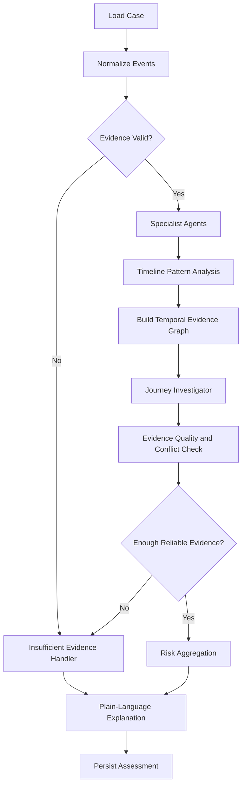

# 4. LangGraph Multi-Agent Workflow

## 4.1 Required Principle
LangGraph must actually orchestrate the investigation. Importing LangGraph without using a state graph is not acceptable.

## 4.2 State
Define a typed state object containing:
- case metadata
- normalized events
- extraction results
- per-agent structured findings
- temporal graph
- candidate journey hypotheses
- evidence quality/conflict report
- risk assessment
- explanation/recommendations
- execution status/errors
- analysis version and timestamps

Do not store API secrets in graph state.

## 4.3 Nodes
1. `load_case`
2. `normalize_events`
3. `message_analysis`
4. `link_qr_analysis`
5. `payment_event_analysis`
6. `timeline_pattern_analysis`
7. `build_temporal_graph`
8. `investigate_journey`
9. `check_evidence_quality`
10. `aggregate_risk`
11. `generate_explanation`
12. `persist_results`
13. `handle_insufficient_evidence`
14. `handle_agent_failure`

Use parallel execution for independent specialist analyses if supported cleanly by the installed LangGraph version. Otherwise use explicit sequential nodes while preserving separate agent contracts.

## 4.4 Workflow Diagram

## 4.5 Conditional Paths
- Invalid or empty case → controlled validation result.
- Offline mode → deterministic agent implementations.
- LLM unavailable → fallback; do not crash.
- Invalid structured model output → bounded retry, then fallback/error.
- Conflicting agent findings → evidence quality node marks disagreement.
- Insufficient evidence → explicit uncertainty state.
- New event appended → rerun affected analyses and regenerate assessment.
- Parser failure → preserve raw event safely and mark parser status.

## 4.6 Agent Contracts
Every agent returns:
- agent name/version
- status
- summary
- indicators
- evidence references (`event_id`, optional evidence span/field)
- confidence or qualitative certainty
- uncertainty/limitations
- structured output validated by Pydantic

Agents must not invent event IDs or entities absent from input.

## 4.7 Logging and Observability
Record node start/end/status, duration, and sanitized error summaries. Do not log credentials or sensitive raw payloads by default.
